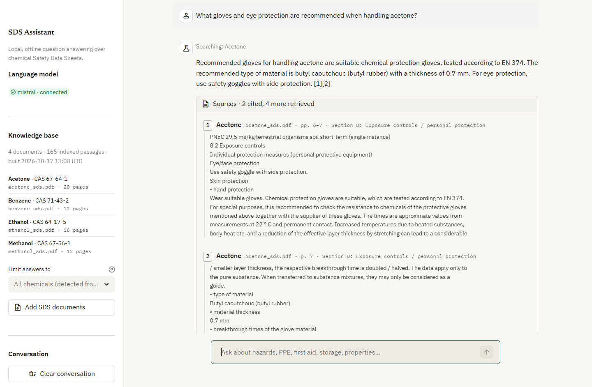
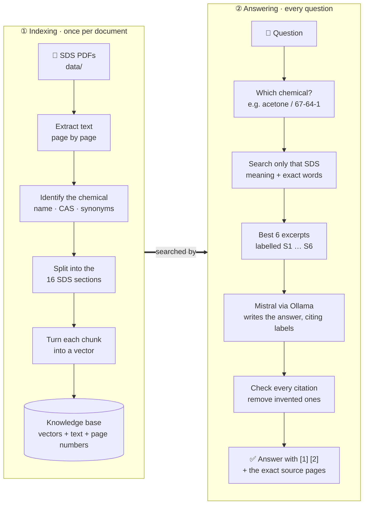

# Chemical Safety RAG Assistant

[](https://github.com/Mona-Agrawall/chemical-safety-rag-assistant/actions/workflows/ci.yml)


[](LICENSE)

**Ask plain-English questions about chemical Safety Data Sheets and get answers that cite the exact
document and page they came from.**

Hazards, protective equipment, first aid, storage, physical properties: answers are drawn only from
the SDS documents in your knowledge base, generated by a local LLM, with every citation checked
against the passages that were actually retrieved. No API keys, and no data leaves your machine.



> [!WARNING]
> **Not a substitute for the official SDS.** Answers come from the indexed documents and can be
> incomplete or out of date. Always consult the supplier's current Safety Data Sheet and follow your
> site procedures. In an emergency, call your local emergency number or poison control centre.

**Contents:** [Highlights](#highlights) · [Quick start](#quick-start) · [Using the app](#using-the-app) ·
[How it works](#how-it-works) · [Evaluation](#evaluation) · [Configuration](#configuration) ·
[Knowledge base](#managing-the-knowledge-base) · [Testing](#testing) · [Deployment](#deployment) ·
[Troubleshooting](#troubleshooting) · [Project structure](#project-structure) ·
[Limitations](#known-limitations) · [License](#license)

---

## Highlights

- **Verifiable answers.** Every statement is cited as `[1]`, `[2]` and linked to the source passage,
  file, page and SDS section. Citations the model invents are detected and removed.
- **No cross-chemical mix-ups.** Questions are matched to chemicals by name, alias (*methyl alcohol*,
  *2-propanone*) or CAS number, and only those chemicals' SDSs are searched. Wrong-chemical
  retrievals dropped from 30% to 0%.
- **Honest about gaps.** If the documents don't contain the answer, it says so. Questions about a
  chemical with no SDS in the knowledge base are answered immediately, without guessing.
- **Built for SDS documents.** PDFs are split along the 16 standard SDS sections, and hybrid search
  (vector + keyword) finds exact identifiers such as CAS numbers, UN numbers and H-statements.
- **Live knowledge base.** Upload new SDS PDFs in the app. They are validated, de-duplicated and
  indexed incrementally, and a failed update never corrupts the existing index.
- **Measured, not assumed.** A 51-question evaluation set with page-level ground truth tracks
  retrieval and answer quality against the previous version.

## Quick start

### Local

**Requirements:** Python 3.11+, [Ollama](https://ollama.com/download), and about 8 GB of free RAM
for Mistral 7B on CPU (a GPU is optional and much faster).

```bash
# 1. Download the model (once, ~4.4 GB)
ollama pull mistral

# 2. Create a virtual environment and install dependencies
python -m venv venv
venv\Scripts\activate            # Windows
# source venv/bin/activate       # macOS / Linux
pip install -r requirements.txt

# 3. Build the knowledge base from the PDFs in data/ (~20 s)
python ingest.py

# 4. Start the app
streamlit run app.py
```

Open <http://localhost:8501>. On Linux without a GPU, install the smaller CPU build of PyTorch first:
`pip install --index-url https://download.pytorch.org/whl/cpu torch==2.11.0`.

### Docker

The compose file runs the app and an Ollama server as two containers. The model is not bundled in
any image; pull it once into a persistent volume.

```bash
docker compose up -d --build
docker compose exec ollama ollama pull mistral   # once
```

Open <http://localhost:8501>. Stop with `docker compose down` (data is kept; add `-v` to delete it).
For an NVIDIA GPU: `docker compose -f docker-compose.yml -f docker-compose.gpu.yml up -d`.

## Using the app

| To… | Do this |
|---|---|
| Ask a question | Type in the chat box, or click one of the example questions |
| Check the evidence | Open **Sources** under an answer: each passage with its file, page and SDS section |
| Focus on certain chemicals | Sidebar → **Limit answers to** (by default, chemicals are detected from the question) |
| Ask a follow-up | "What about its UN number?" keeps the chemical from the previous question |
| Add documents | Sidebar → **Add SDS documents** → choose PDFs → **Add to knowledge base** |
| Recover from a model outage | The sidebar shows the Ollama status with a **Check again** button |
| Save or reset the chat | Sidebar → **Conversation** → **Export as Markdown** or **Clear conversation** |

Uploads are checked for file type, size, page count, encryption and extractable text. Scanned
image-only PDFs are rejected because OCR is not supported. The app follows your system's light or
dark theme.

## How it works

The app works in two stages. **Indexing** (`python ingest.py`, or *Add SDS documents* in the app)
turns the PDFs into a searchable knowledge base; **answering** searches it for every question.



| Step | What happens | Code |
|---|---|---|
| Extract text | Reads each PDF page; rejects scanned, encrypted or corrupt files | `rag/loader.py` |
| Identify the chemical | Finds the product name, CAS number and synonyms on the first pages | `rag/chemicals.py` |
| Split into sections | Cuts along SDS Sections 1–16, removes repeated headers, keeps page numbers | `rag/chunking.py` |
| Build the knowledge base | Embeds chunks with all-MiniLM-L6-v2 and saves a versioned FAISS index with a manifest | `rag/embeddings.py`, `rag/indexing.py` |
| Which chemical? | Matches names, aliases and CAS numbers in the question | `rag/chemicals.py` |
| Search | Combines vector search (meaning) with BM25 keyword search (exact terms), fused with Reciprocal Rank Fusion | `rag/retrieval.py`, `rag/bm25.py` |
| Answer | Sends the labelled excerpts to the local model and streams its reply | `rag/pipeline.py`, `rag/llm.py` |
| Check citations | Keeps only labels that were really supplied and maps them to file and page | `rag/citations.py` |

### Design decisions

- **Plain, typed Python instead of a framework.** The pipeline is built directly on `pypdf`,
  `sentence-transformers`, `faiss-cpu` and Ollama's REST API. Chemical scoping, hybrid search,
  label-based citations and streaming with sources stay simple and fully unit-testable.
- **Citations by label, not by model-written file names.** The model only sees and writes labels such
  as `[S2]`; file names and page numbers always come from the retriever's metadata.
- **Documents are treated as untrusted.** Excerpts are fenced inside the prompt, label and tag
  look-alikes in PDF text are neutralised, the model is told to ignore instructions inside documents,
  and rendered answers cannot load images, HTML or remote links.
- **Safe, reproducible index.** The index is stored as `index.faiss`, `chunks.json` and
  `manifest.json` (no pickle, so loading it cannot execute code). The manifest records the embedding
  model, chunking settings and a SHA-256 hash of every document, and the app refuses an index built
  with a different embedding model.

## Evaluation

`eval/questions.json` contains 51 questions about the four bundled SDSs, each with ground-truth pages
verified against the PDF text. They cover identifiers, numeric properties with units, hazards, first
aid, storage, exposure controls, aliases, CAS look-ups, multi-chemical comparisons, multi-section
questions and unanswerable questions.

Results below compare this version with the previous one (v2). They were measured on a 12-core laptop
CPU without a GPU, using Mistral 7B (Q4).

**Retrieval** (all 51 questions):

| Metric | v2 | v3 |
|---|---|---|
| Correct page in top 1 (hit@1) | 0.327 | **0.837** |
| Correct page in top 3 (hit@3) | 0.551 | **0.980** |
| Correct page in top 5 (hit@5) | 0.653 | **1.000** |
| Mean reciprocal rank | 0.469 | **0.926** |
| Retrieved passages from the wrong chemical | 30% | **0%** |

**Answers** (46 questions with completed runs for both versions):

| Metric | v2 | v3 |
|---|---|---|
| Expected facts present in the answer | 0.565 | **0.913** |
| Answers with no citation | 16 of 46 | **0 of 46** |
| Citations pointing to a retrieved passage | 0.781 | **1.000** |
| Median answer time (CPU) | 42.7 s | 41.0 s |

How to read these numbers:

- Retrieval counts a hit only if a passage from the right document **and page** is retrieved. For
  multi-chemical questions, every chemical's page must be found.
- "Expected facts present" is an automated check that key values (for example `-17`, `butyl`,
  `H225`) appear in the answer. It is a proxy, not a human judgement of answer quality.
- v2 asked the model to write file names and pages itself, so its citation figure covers only the
  citations that could be parsed. In v3 every citation is a validated label.
- The question set was also used during development, so these are development-set results on four
  documents rather than a held-out benchmark. Answer times are approximate.

### Retrieval design choices

Measured with all-MiniLM-L6-v2 and 1,000-character chunks (`eval/results/retrieval_comparison.json`):

| Variant | hit@1 | hit@5 | MRR | Wrong-chemical passages |
|---|---|---|---|---|
| Vector search only | 0.776 | 0.939 | 0.845 | 8.4% |
| Vector + chemical filter | 0.796 | 0.959 | 0.874 | 0% |
| Hybrid (vector + BM25), no filter | 0.857 | 0.980 | 0.926 | 22.8% |
| **Hybrid + chemical filter (default)** | 0.837 | **1.000** | 0.926 | **0%** |
| Hybrid + filter + cross-encoder reranker | 0.898 | 1.000 | 0.961 | 0% |

- **Embedding model.** BGE-small-en-v1.5 (MRR 0.937) and E5-small-v2 (MRR 0.940) performed within
  noise of all-MiniLM-L6-v2 (MRR 0.926). MiniLM was kept as the smallest and fastest.
- **Reranker.** Improves ranking order (hit@1 0.84 → 0.90) but adds about 1.4 s per question on CPU,
  while hit@5 is already 1.0. Available with `RERANKER_ENABLED=true`, off by default.
- **Chunk size.** 800, 1,000 and 1,400 characters performed within one question of each other.

### Reproduce

```bash
python scripts/evaluate.py retrieval      # retrieval metrics, no LLM needed (seconds)
python scripts/evaluate.py retrieval --models sentence-transformers/all-MiniLM-L6-v2,BAAI/bge-small-en-v1.5 \
       --chunk-sizes 800,1000,1400 --rerank
python scripts/evaluate.py answers        # full pipeline with Ollama (about an hour on CPU)
```

Results are written to `eval/results/`.

## Configuration

Every setting is optional and read from environment variables or a `.env` file (copy
`.env.example`). Invalid values stop the app with a message naming the variable.

| Variable | Default | Purpose |
|---|---|---|
| `OLLAMA_BASE_URL` | `http://localhost:11434` | Ollama server address |
| `OLLAMA_MODEL` | `mistral` | Model name as shown by `ollama list` |
| `LLM_TEMPERATURE` | `0.0` | Sampling temperature |
| `LLM_NUM_CTX` | `8192` | Context window passed to Ollama |
| `LLM_CONNECT_TIMEOUT_S` / `LLM_READ_TIMEOUT_S` | `5` / `180` | Request timeouts (seconds) |
| `HEALTH_TIMEOUT_S` | `3` | Ollama health-check timeout (seconds) |
| `EMBEDDING_MODEL` | `sentence-transformers/all-MiniLM-L6-v2` | Changing it requires `python ingest.py --rebuild` |
| `EMBEDDING_DEVICE` | `cpu` | `cuda` to use a GPU |
| `CHUNK_SIZE` / `CHUNK_OVERLAP` | `1000` / `150` | Characters; changing them requires a rebuild |
| `TOP_K` | `6` | Excerpts sent to the model |
| `CANDIDATE_K` | `30` | Candidates per retriever before fusion |
| `HYBRID_SEARCH` | `true` | Combine vector and BM25 search |
| `RRF_K` | `60` | Reciprocal Rank Fusion constant |
| `RERANKER_ENABLED` / `RERANKER_MODEL` | `false` / `cross-encoder/ms-marco-MiniLM-L-6-v2` | Optional reranking |
| `MAX_HISTORY_TURNS` | `4` | Conversation turns sent to the model |
| `DOCS_DIR` | `data` | PDF folder (searched recursively); uploads go to `DOCS_DIR/uploads` |
| `INDEX_DIR` | `storage/index` | Generated index |
| `MAX_UPLOAD_MB` / `MAX_PDF_PAGES` / `MAX_QUESTION_CHARS` | `20` / `200` / `2000` | Resource limits |
| `LOG_LEVEL` | `INFO` | Logs record timings and counts, not question text |

## Managing the knowledge base

```bash
python ingest.py            # incremental: embeds only new or changed PDFs, drops deleted ones
python ingest.py --rebuild  # re-embed everything (after changing EMBEDDING_MODEL or CHUNK_*)
python ingest.py --check    # report status; exits with 1 if the index is missing, stale or incompatible
```

- Add PDFs by copying them into `data/` and running `python ingest.py`, by clicking **Update index**
  when the app detects changes, or by uploading them in the app.
- Documents are tracked by SHA-256 hash: edited files are re-embedded, renamed files keep their
  vectors, and identical copies are indexed once.
- Each build is written to a new version folder and switched in atomically. The previous version is
  kept, and a failed build leaves the current index in use. If one file in a multi-file upload fails,
  only that file is rolled back.

## Testing

```bash
pip install -r requirements-dev.txt
pytest -m "not live"     # 177 unit, integration, UI and real-PDF tests (no model server needed)
pytest -m live           # end-to-end tests against a running Ollama
ruff check . && mypy     # lint and type check
```

- Unit and integration tests use synthetic PDFs and deterministic stand-ins for the embedding model
  and LLM, so they run quickly without downloads.
- `tests/test_real_corpus.py` checks chemical identification, section detection, page numbers and
  retrieval quality on the four bundled PDFs.
- `tests/test_app.py` drives the real Streamlit app with Streamlit's `AppTest`.
- `scripts/ui_smoke.py` checks a running app in headless Chrome (layout, dark mode, phone width,
  keyboard focus and, with `--ask`, a real streamed answer) and saves screenshots.
- GitHub Actions runs lint, type checks and the non-live tests on every push and pull request.

## Deployment

- **Resources.** The app image is about 2.9 GB (CPU-only PyTorch, embedding model included) and the
  app uses about 1.5 GB of RAM. Ollama with Mistral 7B (Q4) needs about 6 GB of RAM. Expect 20–90 s
  per answer on a laptop CPU and a few seconds on a GPU.
- **Storage.** Mount persistent storage for the documents folder and the index; otherwise uploads are
  lost on restart. The bundled documents and their index are rebuilt automatically.
- **Hosting.** The app needs a reachable Ollama server, so platforms such as Streamlit Community
  Cloud (no Ollama, ephemeral disk) cannot run the full stack. Use a VM or container host with enough
  RAM or a GPU, run the compose stack, and put it behind a reverse proxy with authentication if it is
  reachable beyond a trusted network. The app has no user accounts of its own.
- **Security.** No secrets are required. Uploads are validated and limited in size and pages, errors
  are logged server-side without being shown to users, XSRF protection is enabled, and index writes
  are serialised with a lock.

## Troubleshooting

| Symptom | Fix |
|---|---|
| Sidebar shows **Ollama · offline** | Start Ollama (`ollama serve` or the desktop app), then click **Check again** |
| **Model not installed** | `ollama pull mistral`, or set `OLLAMA_MODEL` to a model from `ollama list` |
| **Index was built with embedding model …** | `EMBEDDING_MODEL` changed: run `python ingest.py --rebuild` or click **Rebuild index** |
| **Documents folder changed since indexing** | Click **Update index** or run `python ingest.py` |
| **The knowledge base is already being updated** | Another session is writing the index; wait and retry (stale locks clear after 30 minutes) |
| Upload rejected as scanned | The PDF has no text layer; run OCR first or use a text-based SDS |
| Answers are slow | Expected on CPU; use a GPU, a smaller model or a lower `TOP_K` |
| First start is slow | The embedding model (~90 MB) is downloaded once and the index is built |

## Project structure

```
app.py                  Streamlit UI (state and rendering only)
ingest.py               CLI to build, update or check the index
rag/
  config.py             environment-driven settings and validation
  loader.py             PDF validation and text extraction
  chemicals.py          chemical identity extraction and question matching
  chunking.py           SDS section detection and page-tracked chunks
  embeddings.py         sentence-transformers wrapper
  indexing.py           versioned index, manifest, incremental sync, locking
  bm25.py               keyword index
  retrieval.py          chemical-scoped hybrid retrieval (FAISS + BM25 + RRF)
  rerank.py             optional cross-encoder reranker
  citations.py          source labels, context formatting, citation checks
  prompts.py            system prompt and fixed answers
  pipeline.py           retrieve → generate → validate
  llm.py, health.py     Ollama streaming client and health check
  uploads.py            upload validation, staging and rollback
  export.py             Markdown conversation export
  evaluation.py         retrieval and answer metrics
ui/                     UI components and CSS
scripts/                evaluation runner and browser smoke test
eval/                   evaluation questions and results
tests/                  pytest suite
data/                   bundled SDS PDFs (uploads go to data/uploads/, not tracked)
docs/                   README assets
.streamlit/config.toml  theme (light and dark) and server settings
Dockerfile, docker-compose.yml, docker-compose.gpu.yml, docker/entrypoint.sh
```

## Known limitations

- **PDF layout.** Text is extracted with `pypdf`; some layouts (for example the bundled benzene SDS)
  come out with words joined together or out of order. Retrieval copes, but a fact can occasionally
  land in a neighbouring section's chunk. Page numbers stay correct.
- **No OCR.** Scanned, image-only SDSs are rejected.
- **Small evaluation set.** 51 questions over four documents, checked automatically.
- **One chemical per SDS.** Mixtures are indexed under their product name; questions about individual
  components of a mixture are not mapped to them.
- **Follow-up questions** reuse the chemical from the previous question rather than being rewritten
  by the model.
- **No stop button** while an answer is streaming; sending a new question interrupts it, and the
  partial answer is marked as interrupted.
- **On phones**, Streamlit opens chat pages scrolled to the bottom, so the title is just above the
  first screen.

## Changelog

**v3.0**
- Rebuilt the RAG pipeline as a typed `rag/` package with label-based, validated citations.
- Chemical identity extraction and chemical-scoped retrieval (wrong-chemical retrievals 30% → 0%).
- SDS-section chunking, hybrid FAISS + BM25 retrieval, and a versioned index with manifest,
  incremental sync and atomic updates.
- Streaming answers, Ollama health check with retry, in-app uploads, Markdown export and a
  redesigned light/dark interface.
- Evaluation set and runner, 177 automated tests, Docker setup and GitHub Actions CI.

**v2.0**
- Ollama health check, conversation history window, source de-duplication, CLI ingestion and
  restyled UI.

## License

Released under the [MIT License](LICENSE). © 2026 Mona Agrawal.
